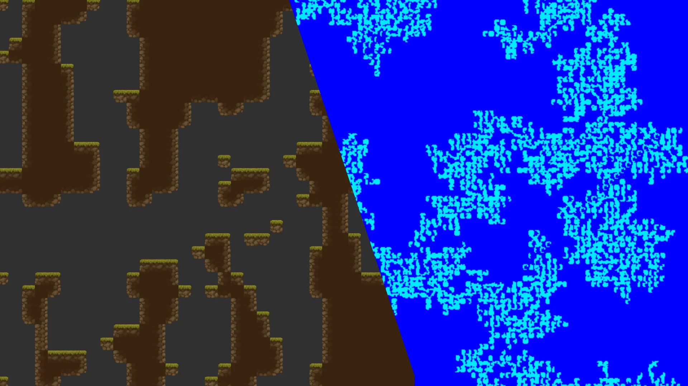
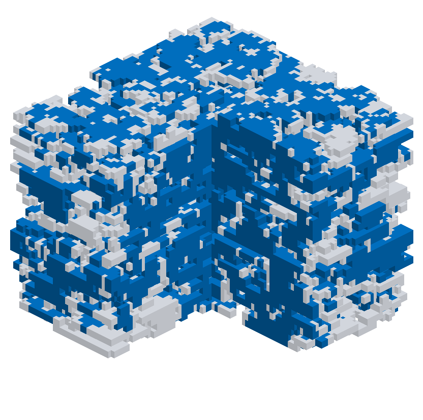
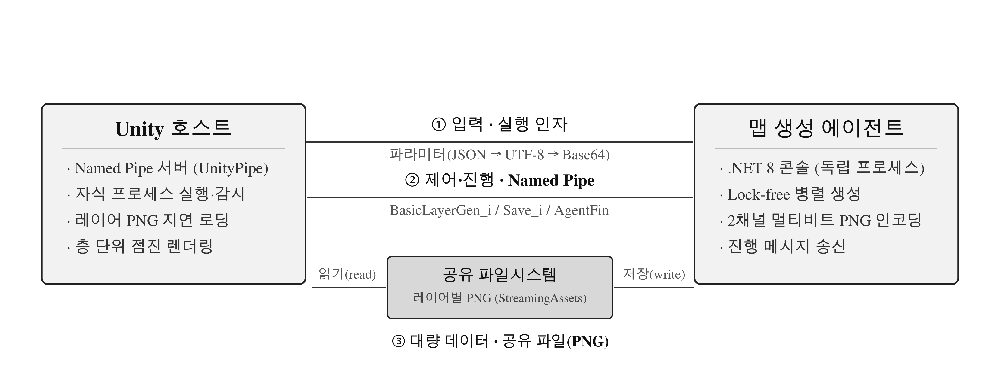

# Massive Map Gen System

**A hierarchical random-walk algorithm for large-scale tilemap generation, with an execution strategy that keeps the game host responsive.**

Korea Multimedia Society Fall Conference 2026 · Hyun-su Yu, Jeong-guk Koh (Tongmyong University)



*A generated tilemap: in-engine render (left) and the agent's raw 2-channel PNG output (right).*

Generating a 3D tilemap of hundreds of millions of tiles on a game engine's main thread causes frame freezes and large GC stalls. This project offloads generation to a separate process and parallelizes it lock-free, so the Unity host stays responsive while a ~270M-tile map is built.

## Highlights
- **Hierarchical generation.** `Abstract → Room → Tile` layers; probabilistic random walk + flood-fill for in-layer corridors, BFS vertical gates for inter-layer links (inspired by Spelunky 2).
- **Host-responsive execution.** Generation runs in a separate .NET agent process, linked to Unity by three IPC channels.
- **Lock-free parallelism.** Disjoint region partitioning plus a per-task thread-local xorshift RNG. No mutex on the compute path, and output is deterministic per seed.

## Results
3000×3000×30 ≈ 270M tiles, on i9-13900HX / RTX 4070 Laptop / Unity 6000.3.6f1 (Mono).

**Structural quality.** 63.5% of all passable tiles form a single 3D connected component, and the bottom layer reaches the top through gates. Dead-end tile rate is 0.28%, and shape diversity across seeds is Jaccard 0.926.



*Cutaway of the single 3D connected component (blue, 63.5%); translucent gray marks the intentionally scattered side rooms.*

**Execution strategy** (10 runs):

| Metric | A: Job System+Burst | B: Main Thread | Proposed: IPC+Agent |
|---|--:|--:|--:|
| Generation (s) | 3.565 | 239.358 | 22.467 |
| Effective FPS | 29.31 | 0.257 | **51.26** |
| Worst frame (ms) | 2750.3 | 252161.8 | **230.3** |
| Host managed alloc | 10.5 KB | ~21.9 GB | 118 KB |

The proposed agent is not the fastest to generate, but during generation it keeps the **highest host FPS and the lowest worst-frame**. Its value is host responsiveness and heap/address-space isolation, not raw speed.

**Storage.** The 2-channel PNG output is 14.6 MB, about 5.41% of the 270 MB raw tile array, trading capacity for I/O time.

## How it works



Two processes connected by three IPC channels:
1. **Exec args** carry input parameters as JSON then Base64.
2. **Named Pipe** streams async progress and finish events, so the main thread never blocks.
3. **Shared PNG files** hold the finished map (hundreds of MB) as per-layer PNGs, lazily loaded by the host.

Generation runs on the `.NET ThreadPool` in barrier-synchronized batches (default cap 64). Because layers and room/gate blocks write to disjoint memory and each task uses a coordinate-seeded local RNG, the compute path needs no locks and reproduces identically for a given seed.

## Build and run
- **Runtime:** .NET 8 · **Package:** SkiaSharp
- **External references:** `Unite2026Seoul_MapGenCommonLib` (MapActiveType, FastRandom, multibit-encoding constants) and Newtonsoft.Json. This repository contains the agent project only, so CommonLib must be provided to build.
- The `Release` configuration defines `BENCHMARK; UNIT_TEST`, which allows standalone, benchmarked runs with hard-coded input (no Unity pipe required).

## Repository layout
```
Manager/Main.cs                     entry point, pipe link, layer PNG save
Functor/Agent/BasicMapGenAgent.cs   generation (Abstract/Room/Tile, gates, parallelism)
Functor/Buffer/...InputBuffer.cs    input parameter buffer
Functor/Utils/RandUtil.cs           RNG helpers
```

## License
See [LICENSE](LICENSE).
